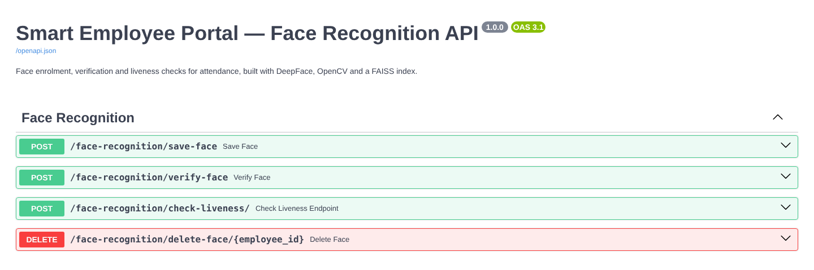
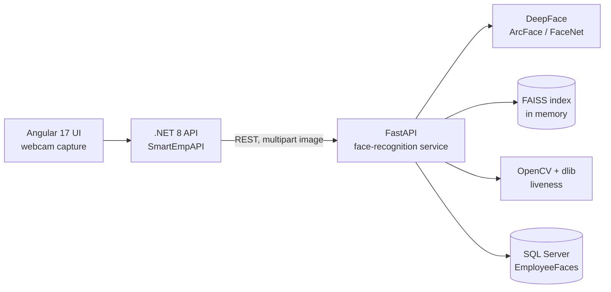

# 👁️ Smart Employee Portal — Face Recognition Service

> Biometric attendance microservice for the **Smart Employee Portal**. Built with **FastAPI**, **DeepFace (ArcFace / FaceNet)**, **FAISS** and **OpenCV**, it enrols employee faces, verifies them at check-in and runs a basic liveness check — and is called by the [.NET backend](https://github.com/yasirmalik36/smart-employee-portal-backend) over REST.

[](https://python.org)
[](https://fastapi.tiangolo.com)
[](https://opencv.org)
[](https://faiss.ai)
[](LICENSE)

---

## 📸 Screenshot

The interactive API docs (`/docs`), served by the running service:



## ✨ What it does

| Capability | How it works |
|---|---|
| 👤 **Enrolment** — `POST /face-recognition/save-face` | Detects a face in the uploaded photo, stores the image and its embedding against an `EmployeeID` in SQL Server |
| ✅ **Verification** — `POST /face-recognition/verify-face` | Embeds the probe image with **ArcFace** (512-d), searches a **FAISS** `IndexFlatL2` of enrolled faces, then falls back to **DeepFace.verify (FaceNet)** against stored images |
| 🛡️ **Liveness check** — `POST /face-recognition/check-liveness/` | Face detection with **dlib** plus optical-flow motion analysis in **OpenCV** to reject static photos |
| 🗑️ **Removal** — `DELETE /face-recognition/delete-face/{employee_id}` | Deletes an employee's face record and rebuilds the index |
| 📖 **Docs** | Interactive Swagger UI at `/docs` (the root URL redirects there) |

Responses use the portal's shared envelope: `{ "code": "00", "message": "Success", "description": "..." }`.

---

## 🏗️ Architecture



```
app/
├── main.py                 # FastAPI app, mounts the router, / → /docs
├── config.py               # Settings from environment variables
├── routes/face_recognition.py
├── services/
│   ├── database.py         # pyodbc helpers (parameterised queries)
│   ├── face_processing.py
│   └── liveness.py         # dlib + optical-flow liveness check
└── utils/
run.py                      # uvicorn entry point (127.0.0.1:8000)
```

---

## 🚀 Getting started

### Prerequisites

- Python 3.10+
- SQL Server with the `SMART_EMP` database and an `EmployeeFaces` table (schema not included in this repo)
- [Microsoft ODBC Driver 18 for SQL Server](https://learn.microsoft.com/sql/connect/odbc/download-odbc-driver-for-sql-server)
- CMake and a C++ compiler (required to build `dlib`)

### Install and run

```bash
git clone https://github.com/yasirmalik36/smart-employee-portal-face-recognition.git
cd smart-employee-portal-face-recognition

python -m venv .venv
source .venv/bin/activate        # Windows: .venv\Scripts\activate
pip install -r requirements.txt

export DB_CONNECTION_STRING="DRIVER={ODBC Driver 18 for SQL Server};SERVER=localhost;DATABASE=SMART_EMP;Trusted_Connection=yes;TrustServerCertificate=yes"
python run.py
```

The service starts at **http://127.0.0.1:8000** — open `/docs` for Swagger UI. The first start downloads the DeepFace model weights.

### Configuration

| Variable | Default | Purpose |
|---|---|---|
| `DB_CONNECTION_STRING` | local SQL Server, `SMART_EMP` | pyodbc connection string |

Enrolled images are written to `images/faces/` at runtime. That folder is git-ignored: **face images are biometric personal data and must never be committed.**

---

## 🔗 Related repositories

- [smart-employee-portal-backend](https://github.com/yasirmalik36/smart-employee-portal-backend) — .NET 8 API
- [smart-employee-portal-frontend](https://github.com/yasirmalik36/smart-employee-portal-frontend) — Angular 17 UI

## 📄 License

MIT — see [LICENSE](LICENSE).

---

<div align="center">

Built by **[Yasir Mehmood](https://yasir-portfolio-omega.vercel.app)** · [LinkedIn](https://linkedin.com/in/yasir-mehmood-53549a1b3) · [GitHub](https://github.com/yasirmalik36)

</div>
